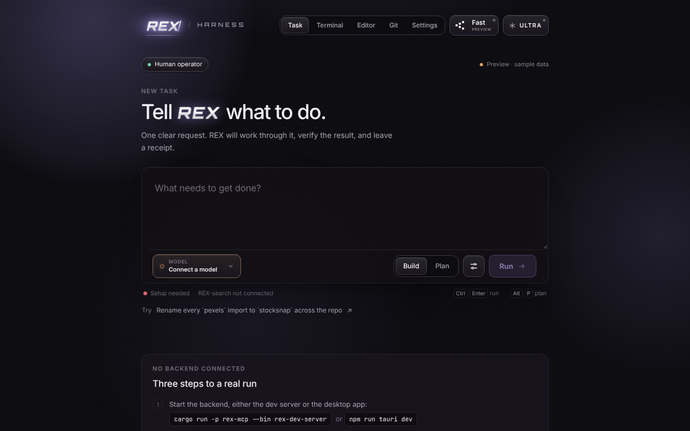
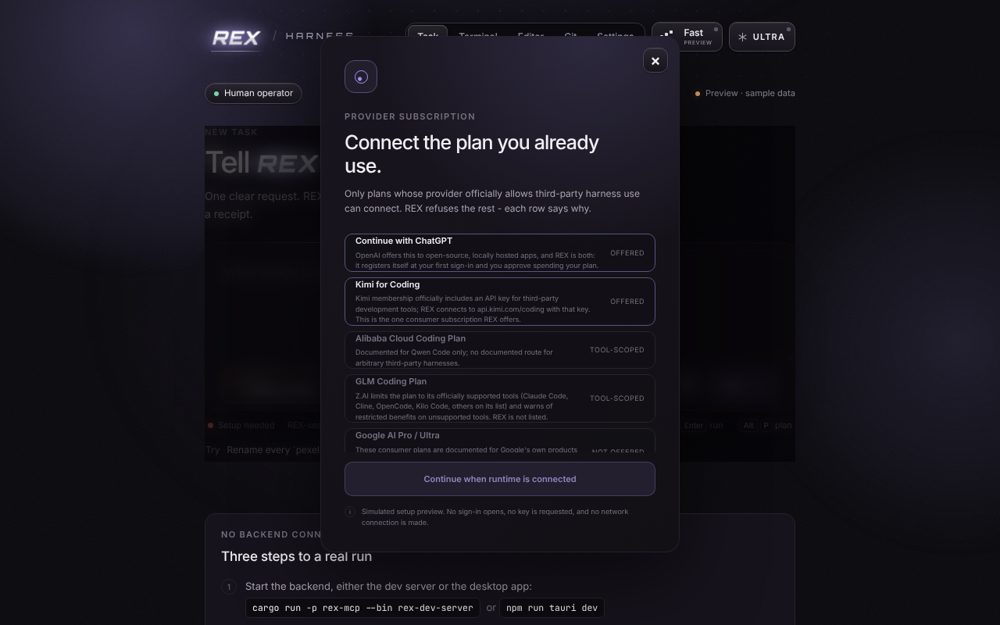

<h1 align="center">REX Harness</h1>

<p align="center">
  <b>AI coding agents you can supervise, budget and verify.</b><br>
  You approve every change. Every run has hard limits. Every result is a signed receipt.<br>
  Open source. Runs on your computer. No account, no server.
</p>

<p align="center">
  <a href="https://github.com/REX-codebase/rex-harness/releases/latest"><b>Download for Windows</b></a> ·
  <a href="docs/getting-started.md">Getting started</a> ·
  <a href="docs/README.md">Documentation</a> ·
  <a href="CHANGELOG.md">Changelog</a>
</p>

<p align="center">
  <a href="https://github.com/REX-codebase/rex-harness/actions/workflows/ci.yml"></a>
  
</p>

<p align="center">
  <br>
  <sub>The interface, shown without a backend connected, so it runs on labelled sample data.</sub>
</p>

## What it is

REX Harness is a desktop app, a command line (`rex`) and a local server that run
an AI model against your code **under rules the model cannot talk its way out
of**:

- **You decide.** The agent works on a disposable copy of your folder. It
  proposes a plan, then each file write and command appears as an approval with
  the exact diff or argument list. Nothing is applied until you review it.
- **Hard budgets.** Steps, tool calls, tokens and time are limits, not
  suggestions. `--bid` prints the worst-case dollar ceiling before anything runs.
- **Proof, not promises.** A run finishes only when its evidence gates pass; the
  model cannot declare itself done. Every run leaves a receipt signed by your
  machine's key, which `rex verify` and `rex replay` check offline.
- **Your models, your accounts.** Bring an API key for Gemini, Anthropic, OpenAI,
  xAI, DeepSeek, Kimi, Qwen, GLM, NVIDIA NIM, Groq or OpenRouter, point it at a
  local server, or **use your ChatGPT plan** with *Continue with ChatGPT*.
- **Local first.** Keys, your ChatGPT sign-in, run history and receipts live in
  one folder on your machine (encrypted for your account on Windows from
  v0.1.1). REX has no server and no telemetry.

## Install

**Windows:** download the `…x64-setup.exe` from the
[latest release](https://github.com/REX-codebase/rex-harness/releases/latest) and
run the setup wizard. It is not code-signed yet, so SmartScreen may ask you to
choose *More info → Run anyway* ([details](INSTALL.md)).

**From source** (any platform; needs [Rust](https://rustup.rs), Node.js 20+ and the
[Tauri prerequisites](https://v2.tauri.app/start/prerequisites/)):

```bash
git clone https://github.com/REX-codebase/rex-harness
cd rex-harness
./quickstart.sh            # installs dependencies and the `rex` CLI, starts the app
                           # (--build for a production build, --no-app for the CLI only)
```

**Command line only** (Linux x86_64, macOS Apple Silicon; no Rust needed):

```bash
curl -fsSL https://raw.githubusercontent.com/REX-codebase/rex-harness/main/scripts/install.sh | sh
```

It checks the download against its published SHA-256 before installing. Windows and
other platforms: [INSTALL.md](INSTALL.md#command-line-only-rex), or build it with
`cargo install --path crates/rex-cli --locked`.

## Try it

In the app, open the model menu, connect a model, describe a task and press
**Ctrl+Enter**. Or from a terminal:

```bash
rex login chatgpt                       # or set REX_ANTHROPIC_API_KEY, etc.
rex exec --task "add a --verbose flag and prove it works" --workspace . --json
rex runs                                # your history
rex verify receipt.json                 # check a receipt offline
```

The full walk-through is in [Getting started](docs/getting-started.md); every
command is in the [CLI reference](docs/cli.md).

<p align="center">
  <br>
  <sub>REX connects an account only where the provider's own documentation allows third-party tools, and each row says why.</sub>
</p>

## Connecting a model

| Route | How |
| --- | --- |
| **ChatGPT plan** | *Continue with ChatGPT* (app) or `rex login chatgpt`. Uses OpenAI's Sign in with ChatGPT for open-source apps; eligible requests use your plan, not API billing. [How it works](docs/chatgpt-sign-in.md). |
| **API key** | Model menu → *Connect API*, or `REX_<PROVIDER>_API_KEY` for CI. |
| **Free tiers** | NVIDIA NIM, Groq and OpenRouter are presets. The backend waits out rate limits; the lean prompt halves request size. [What to expect](docs/execution-core.md). |
| **Local model** | A local OpenAI-compatible server, no key needed unless it asks. |
| **Other subscriptions** | Kimi for Coding is offered. Claude Pro/Max, Google AI, GLM and Alibaba Coding plans, X Premium and GitHub Copilot are not, each with a sourced reason in [subscription-policy.md](docs/subscription-policy.md). |

## Long runs

By default REX sends one turn at a time, which cannot overflow a context window
and suits small models. For a model with a large window, `--windowed-context`
keeps a real transcript, clears old tool results to stubs, folds old turns into a
summary, recovers from a "too long" refusal, and keeps every original result
retrievable through a `recall` tool. It is opt-in and leaves the default path
untouched: [Windowed context](docs/context-management.md).

## Documentation

| | |
| --- | --- |
| **Use it** | [Getting started](docs/getting-started.md) · [Install](INSTALL.md) · [CLI](docs/cli.md) · [Continue with ChatGPT](docs/chatgpt-sign-in.md) · [Troubleshooting](docs/troubleshooting.md) |
| **Trust it** | [Where your data lives](docs/data-and-storage.md) · [Security model](docs/security.md) · [Account policy](docs/subscription-policy.md) · [Security policy](SECURITY.md) |
| **Understand it** | [Architecture](docs/architecture.md) · [Local tools](docs/local-tools.md) · [Prompt architecture](docs/prompt-architecture.md) · [Ultra mode](docs/ultra-mode.md) |
| **Build on it** | [MCP server](docs/rex-mcp.md) · [Contributing](CONTRIBUTING.md) · [Roadmap](ROADMAP.md) |

The full index is [docs/README.md](docs/README.md).

## Status

REX Harness is `0.x`: it works and is tested, but expect rough edges and
changes. Things worth knowing:

- **"Continue with ChatGPT" has not been exercised against OpenAI's live
  service** yet; it is tested against scripted endpoints and follows OpenAI's
  published contract. [What remains to verify](docs/chatgpt-sign-in.md#not-verified-live).
- The **Windows installer is unsigned** and has had little testing on real
  machines. **v0.1.0 on Windows** keeps its data in the temp folder and unencrypted;
  that is fixed in v0.1.1 ([changelog](CHANGELOG.md)).
- With no backend connected, the web UI is a **labelled preview on sample data**;
  it never pretends to run anything.

## Repository layout

```
src/              React + TypeScript frontend
src-tauri/        Tauri 2 desktop shell and the Windows installer's assets
crates/           Rust core: providers and the agent loop, tools, custody, CLI, MCP, search, ...
extensions/       VS Code extension and JetBrains plugin
actions/rex-run   GitHub Action that runs `rex exec` in CI
packages/         The `rex-mcp` npm launcher
docs/             Documentation
verification/     Screenshots and scripts that verify the interface
```

## Contributing and security

Contributions are welcome: see [CONTRIBUTING.md](CONTRIBUTING.md). Please report
vulnerabilities privately, as described in [SECURITY.md](SECURITY.md).

## License

Licensed under either of

- Apache License, Version 2.0 ([LICENSE-APACHE](LICENSE-APACHE) or <http://www.apache.org/licenses/LICENSE-2.0>)
- MIT license ([LICENSE-MIT](LICENSE-MIT) or <http://opensource.org/licenses/MIT>)

at your option.

Unless you explicitly state otherwise, any contribution intentionally submitted
for inclusion in this project by you, as defined in the Apache-2.0 license, shall
be dual licensed as above, without any additional terms or conditions.
