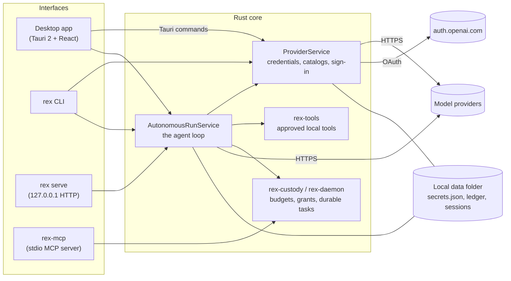

# Architecture

REX Harness is a desktop app, a command line and a local server that all drive
one Rust core. This page is the map: the pieces, how a run flows through them,
and where the trust boundaries are. Deeper detail lives in the pages linked from
each section.

## The big picture

Nothing in the picture is a REX-operated server. The only outbound connections
are to the model provider you connected, optional search providers, and (for
"Continue with ChatGPT") OpenAI's sign-in service.

## The interfaces

| Interface | What it is | Where |
| --- | --- | --- |
| **Desktop app** | Tauri 2 shell with a React + TypeScript + Tailwind frontend. The frontend never touches credentials or models; it calls backend commands and renders what they return. | `src/`, `src-tauri/` |
| **Dev sidecar** | The same services over HTTP on `127.0.0.1:8787`, so `npm run dev` in a browser reaches real providers. A development tool, not the product. | `crates/rex-mcp/src/bin/rex-dev-server.rs` |
| **`rex` CLI** | Headless runs, receipts, sign-in. See [cli.md](cli.md). | `crates/rex-cli` |
| **`rex serve`** | Loopback HTTP API used by the VS Code extension. | `crates/rex-cli/src/serve.rs`, `extensions/vscode` |
| **`rex-mcp`** | A local stdio MCP server that lets an external agent run tasks under REX's custody rules. Also published for `npx`. | `crates/rex-mcp`, `packages/rex-mcp-npm`, [rex-mcp.md](rex-mcp.md) |

When no backend is reachable the web UI shows a clearly labelled preview on
sample data instead of pretending to work.

## What happens in a run

1. **Brief.** A task, a provider and model, budgets, a workspace, and options
   (plan mode, lean prompt, windowed context) become a run.
2. **Stage.** The workspace is copied; the agent only ever sees the copy.
3. **Resolve credentials.** The run asks `ProviderService` for the credential
   **each turn**. An API key never changes; a ChatGPT access token lives about an
   hour and is renewed when near expiry.
4. **Plan (optional).** In plan mode the model proposes a plan and the run parks
   until you approve it. No tool runs before approval.
5. **Turn loop.** Each turn assembles a system prompt from versioned modules
   ([prompt-architecture.md](prompt-architecture.md)), sends the request, and
   decodes the reply into tool calls. Reads run; writes and commands become
   approvals ([local-tools.md](local-tools.md)). Results go back to the model.
6. **Budgets and gates.** Step, tool-call, token and time budgets are checked at
   every turn boundary. A completion claim is verified against the workspace by
   gates; the model cannot declare itself done.
7. **Receipt.** The run ends in a typed terminal state. The CLI signs a receipt
   and appends it to the ledger.

### One loop, four wire formats

`crates/rex-providers/src/autonomous.rs` is the loop. It speaks four protocols,
chosen by the provider: Gemini `generateContent`, Anthropic Messages,
OpenAI-compatible chat completions, and the OpenAI **Responses** API used by the
ChatGPT plan. By default each turn is stateless (system prompt, current state,
the previous turn); `--windowed-context` keeps a managed transcript with tiered
compaction and a `recall` tool for large-window models
([context-management.md](context-management.md)).

## Crates

| Crate | Responsibility |
| --- | --- |
| `rex-providers` | Provider registry and access policy, live model catalogs, credential store, ChatGPT OAuth, the Responses adapter, and the autonomous loop. |
| `rex-tools` | Capability-scoped local tool runtime: bounded argv commands, path and symlink defences, approvals, receipts with bounded diffs. |
| `rex-custody` | Task-scoped custody kernel: budgets that survive crashes, grants that record the operator. |
| `rex-daemon` | Durable task store and scoped execution for external host agents. |
| `rex-mcp` | The stdio MCP server over the custody loop; also hosts the dev sidecar. |
| `rex-protocol` | Versioned protocol types for the MCP surface. |
| `rex-prompt` | Modular system prompt: constitution, roles, tool contracts, epistemic state, gates. |
| `rex-fable` | The Think → Prove → Attack → Write gate with a mechanical authority timer ([ultra-mode.md](ultra-mode.md)). |
| `rex-ultra` | Ultra mode: contract-driven runs with an adversary and a clean-room judge. |
| `rex-preview` | Live-app preview trust boundary: loopback launch plans and evidence gates. |
| `rex-search` | Provider-independent, robots-aware web evidence retrieval ([rex-search.md](rex-search.md)). |
| `rex-installed-agents` | Safe adapters for officially scriptable vendor CLIs (today: Codex). |
| `rex-cli` | The `rex` binary. |
| `rex-mcp-ext` | Client for connecting REX to third-party MCP servers. |

## Trust boundaries

- **Model ↔ machine:** only the typed tool protocol. Approvals are bound to the
  stored request; shells and network clients are denied.
- **Interface ↔ credentials:** credentials exist only in `ProviderService` and
  the store; the interface is told *whether* a credential exists.
- **Loopback services:** `rex serve` and the sidecar are for programs on this
  machine; they are unauthenticated on purpose.
- **Provider access policy:** `crates/rex-providers/src/policy.rs` decides which
  account types REX will connect, from each provider's own documentation
  ([subscription-policy.md](subscription-policy.md)).

See [security.md](security.md) for what is and is not protected.

## Where state lives

One local folder per user: [data-and-storage.md](data-and-storage.md). A run's own
state (ledger, checkpoint, evidence, and the windowed transcript) sits in its run
folder under `agent-runs/`.
